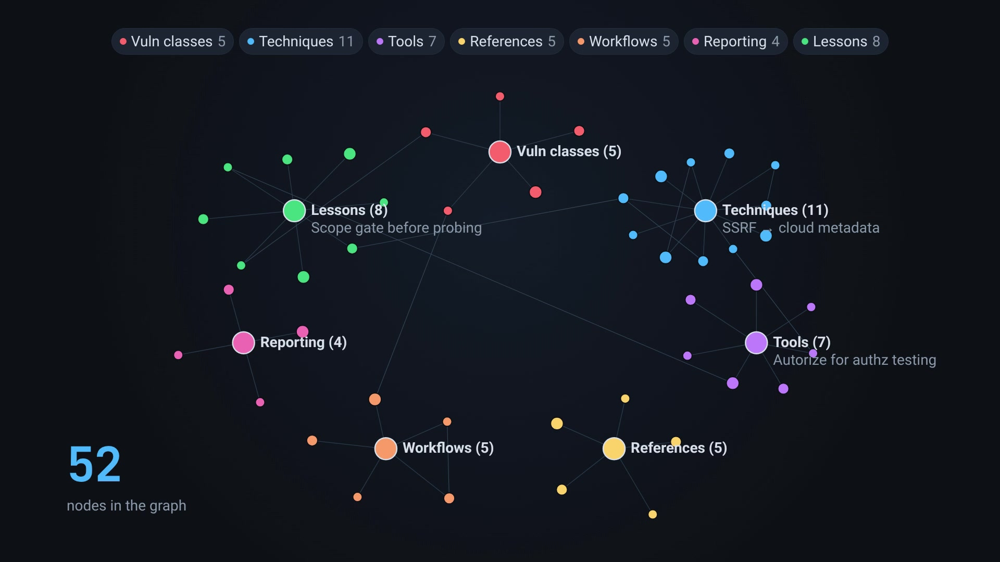

# One_For_All

A Claude Code plugin that gives AI agents a **compounding knowledge graph** for bug
bounty and security assessments. Knowledge learned in one session — techniques,
tools, references, lessons, and reporting insights — is captured, deduped, linked,
and reused by every future session.

Think of it as long-term memory that gets *smarter the more you hunt*, instead of
starting from zero each engagement.

<a href="https://github.com/vivashu27/One_For_All/raw/main/docs/demo.mp4">
  
</a>

<sup>**[▶ Watch the 21s demo](https://github.com/vivashu27/One_For_All/raw/main/docs/demo.mp4)**
&nbsp;·&nbsp; query the graph, load only the node the task needs, compound what you learned
back in. Every node title shown is a generic example, not real graph content.</sup>

## Commands

| Command | When | What it does |
|---|---|---|
| `/build-knowledge [focus]` | During/after an assessment | Harvests durable, reusable knowledge from the session and **compounds** it into the graph — creating new nodes, or reinforcing/merging/superseding existing ones. Never duplicates; always links. |
| `/induce-knowledge [ctx] [--full]` | Start of a new assessment | **Lightweight prime:** loads only a compact, priority-ranked manifest (no bodies) so context stays flat as the graph grows, then recalls full nodes just-in-time. `--full` gives the old deep briefing. |
| `/recall-knowledge <query>` | Mid-task | Just-in-time retrieval: ranks the graph by relevance × priority and loads only the top 1–3 full nodes you need right now. Bumps their usage so useful knowledge rises. |
| `/serve-knowledge [opts]` | Anytime | Launches a local web interface to **view, edit, and share** the graph (interactive force-directed graph, node editor, journal, export/import). Dependency-free; localhost by default. |

Examples:
```
/build-knowledge idor,graphql
/induce-knowledge graphql api oauth      # prime: manifest + focused query, no bodies
/induce-knowledge --full                 # old deep briefing (loads node bodies)
/recall-knowledge ssrf cloud metadata    # pull just the relevant nodes mid-task
/serve-knowledge            # open the web UI at http://127.0.0.1:8787
/serve-knowledge --host 0.0.0.0 --token s3cr3t   # share on the LAN (token-gated)
/serve-knowledge --stop     # stop the server
```

## Priority graph & just-in-time recall (`web/kb.py`)

Inducing the whole graph does not scale — at hundreds of nodes it would eat the model's
context before any work starts. Instead, a stdlib-only CLI (`web/kb.py`, no server
needed) ranks knowledge by a **computed priority score** and loads only what a task
needs, on the fly:

```
priority = 3·confidence + 2·log2(1+reinforced) + 1.5·log2(1+uses) + recency(updated) + (100 if pinned)
```

So battle-tested (`confidence`/`reinforced`), frequently-recalled (`uses`), recently-updated,
and manually **pinned** knowledge floats to the top automatically.

```bash
python3 web/kb.py manifest --top 20          # cheap "what do I know" index (no bodies)
python3 web/kb.py query "graphql idor auth"  # rank by relevance × priority
python3 web/kb.py get idor-id-enumeration    # load the FULL node(s) you need (bumps uses)
python3 web/kb.py pin broken-access-control  # force a node to the top
python3 web/kb.py stats                       # totals + top of the priority graph
```

`/induce-knowledge` runs `manifest` (+ a focused `query`) to prime; during the task the
agent uses `query` → `get` to recall only the 1–3 relevant nodes. `get` bumps each
node's `uses`, so relevance **compounds** the same way knowledge does. Disabled nodes are
excluded from `manifest`/`query`; `--kb` defaults to `~/.claude/bug-bounty-knowledge`.

## Multiple knowledge graphs

You can keep several independent graphs — e.g. one for web bug bounty, one for web3, one
for client pentests — with no shared nodes:

| Graph | Lives at |
|---|---|
| `default` | `~/.claude/bug-bounty-knowledge/` (the original store, never moved) |
| `<name>` | `~/.claude/knowledge-graphs/<name>/` |

```bash
python3 web/kb.py graphs                         # list graphs + node counts
python3 web/kb.py new web3                       # create a new EMPTY graph (--seed to copy seeds)
python3 web/kb.py rename web3 defi_audits        # rename at any time (nodes/links unaffected)
python3 web/kb.py delete web3 --yes              # delete (prompts when interactive)
python3 web/kb.py --graph web3 manifest          # one graph
python3 web/kb.py --graph default,web3 query ... # read several at once (union)
```

- **Compound into a chosen graph:** `/build-knowledge --graph web3` — writes to that graph only.
- **Induce one or several:** `/induce-knowledge --graph default,web3` — with more than one
  loaded, nodes are addressed `graph:slug`, which you pass back to `get`.
- **Serve one in the web UI:** `/serve-knowledge --graph web3` (the UI shows one graph at a time).

Slugs are unique only *within* a graph. A named graph must exist first — the commands
won't create one implicitly.

**Renaming is safe at any time.** Links (`related:`) are always intra-graph slugs and no
node stores its own graph name, so a rename can't dangle a reference; node content,
`uses`, `pin` and `enabled` are all preserved. The ✎ button in the web UI does it too.
Three rules are enforced: `default` can't be renamed (its path is fixed and every command
passes it as `--kb`), the target name must be free, and it must be a valid graph name.

> If you rename the graph a **running** web server was launched against, restart that
> server (`/One_For_All:serve-knowledge --stop`, then start it again) — its `--kb` still
> points at the old directory.

## Automatic awareness (no command needed)

A `SessionStart` hook (`hooks/prime.py`) injects a tiny pointer (~1–2 sentences + the
three `kb.py` commands) into **every new session** when the plugin is enabled, so the
agent knows the graph exists and recalls from it on the fly during security work —
without you typing anything. It loads **no node bodies** (recall stays just-in-time), is
fail-safe (any error → no output, never blocks a session), and emits nothing when the KB
is empty. The `knowledge-graph` skill description is also scoped to trigger at the start
of recon/hunting/reporting tasks, so the model loads it naturally.

> The plugin is installed at **user scope**, so this pointer appears in every project's
> sessions and self-suppresses for non-security work ("if this session is not
> security-related, ignore this note"). To turn it off, remove the `"hooks"` key from
> `.claude-plugin/plugin.json` (or delete `hooks/hooks.json`) and reload.

## Web interface (`/serve-knowledge`)

A self-contained, offline web app (pure Python stdlib server + vanilla JS — **no
dependencies, no CDN**) that reads and writes the same markdown files, so it stays in
sync with `/build-knowledge` and `/induce-knowledge`.

- **View** — searchable sidebar with a **sort** control (by type · A→Z · newest created
  · recently updated), an interactive force-directed graph (drag nodes, hover to
  highlight neighbors, click to open, colored by type, sized by `reinforced`), rendered
  node pages with clickable `[[wikilinks]]`, and the journal.
- **Enable / disable** — toggle any node on/off (the ⏻ button in the list or on a node
  page). Disabling writes `enabled: false` into the `.md` file, greys the node in the UI,
  and **excludes it from `/induce-knowledge`** — a reversible way to retire stale or noisy
  knowledge without deleting it.
- **Filter the graph** — click a legend chip to show/hide that node **type**
  (technique / tool / reference / lesson / workflow / reporting / vuln-class); **All** /
  **None** shortcuts; **Hide disabled** removes retired nodes from the view.
- **Edit** — open a node → **Edit** the raw markdown+frontmatter → **Save** (the `id`
  is validated against the slug and `updated` is set automatically); **New node** via a
  dialog; **Delete**; **Reindex** regenerates `INDEX.md` from the nodes.
- **Share / backup** — **Export** the whole graph as `.zip` (markdown) or `.json`,
  **Import** a teammate's `.json`, or serve live on the LAN with `--host 0.0.0.0`
  `--token <secret>` so a teammate with the link can view/edit.

Safety: binds to `127.0.0.1` only unless you pass `--host`; slugs are strictly
validated and all file access is confined to `nodes/`; non-localhost binds print a
warning and should be paired with `--token` (the UI forwards the token on every API
call). Writes are additionally protected against cross-site requests (any POST/PUT/DELETE
carrying a foreign `Origin` is refused, so a web page you visit cannot touch your
knowledge base), capped at 8 MB per request, serialised with a lock, and written
atomically.

Tests: `./tests/run.sh` — plain `python3` + `node`, no framework or dependencies. Run it directly without the plugin if you like:
`python3 web/server.py --kb ~/.claude/bug-bounty-knowledge`.

## What gets stored

Generalizable, reusable knowledge across these categories:
- **techniques / tricks** that worked
- **tools** recommended for a specific job (with how/why)
- **references / links** for red teaming, security, and bug bounty
- **lessons learned** (including process and pitfalls)
- **workflows** and **reporting** insights

It explicitly does **not** store client/target-specific data, credentials,
hostnames, PII, or secrets — only sanitized, reusable knowledge. See the safety
rules in the skill.

## How it works

- Storage: a global, per-user knowledge base at `~/.claude/bug-bounty-knowledge/`
  (independent of any assessment's working directory, so it is shared by every
  session).
  - `INDEX.md` — the graph hub (nodes grouped by type + a link map)
  - `JOURNAL.md` — dated log of how the graph grew
  - `nodes/<slug>.md` — one node per idea; frontmatter metadata + `[[wikilink]]` edges
- The plugin ships starter knowledge in `knowledge-seed/`, copied into the live
  store on first run (idempotent — your edits are never overwritten).
- Both commands delegate the storage/dedup/linking/traversal mechanics to the
  bundled **`knowledge-graph`** skill (`skills/knowledge-graph/SKILL.md`).

```
Bug_Bounty_Knowledge_Memory_builder/
├── .claude-plugin/
│   ├── plugin.json           # plugin manifest
│   └── marketplace.json      # local marketplace wrapper (for easy install)
├── commands/
│   ├── build-knowledge.md    # /build-knowledge
│   ├── induce-knowledge.md   # /induce-knowledge  (lightweight prime)
│   ├── recall-knowledge.md   # /recall-knowledge  (just-in-time retrieval)
│   └── serve-knowledge.md    # /serve-knowledge
├── skills/knowledge-graph/
│   └── SKILL.md              # storage schema, dedup/merge, priority graph, recall
├── hooks/                    # auto-awareness
│   ├── hooks.json            # SessionStart hook registration
│   └── prime.py              # injects a tiny KB pointer into every session
├── tests/                    # no framework: python3 + node. Run: ./tests/run.sh
├── web/                      # local web interface + retrieval CLI (dependency-free)
│   ├── server.py             # stdlib HTTP server: JSON API + static files
│   ├── kb.py                 # priority-ranked, just-in-time recall CLI
│   └── static/               # index.html, style.css, app.js (offline UI)
├── knowledge-seed/           # starter graph (template, copied to the live store)
│   ├── INDEX.md
│   ├── JOURNAL.md
│   └── nodes/*.md
└── README.md
```

## Install

From Claude Code, register this directory as a local marketplace and install the
plugin:

```
/plugin marketplace add /home/pentest/Desktop/Bug_Bounty_Knowledge_Memory_builder
/plugin install One_For_All@bug-bounty-knowledge-marketplace
```

(The `marketplace add` path is the project **folder**, which is unchanged; only the
plugin name is now `One_For_All`.) Then restart/reload (`/reload-plugins`) so the
commands and skill register. Verify with `/help` — you should see `/build-knowledge`,
`/induce-knowledge`, `/recall-knowledge`, and `/serve-knowledge`.

> The live knowledge base persists at `~/.claude/bug-bounty-knowledge/` across
> sessions and survives plugin updates. To reset it, delete that directory; the
> seed will be recreated on the next run.

## Typical loop

1. New engagement → `/induce-knowledge <stack/target>` to load what you already know.
2. Hunt. Confirm or discover techniques, tools, lessons.
3. `/build-knowledge` → fold the new knowledge back in. Confidence rises as the same
   knowledge is reinforced across independent assessments.
